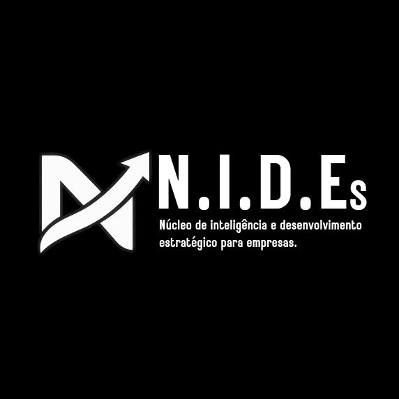

  

  <a href="https://ficca.online/nides">🌐 ficca.online/nides</a>

  
  &nbsp;
  
  &nbsp;
  

# NIDES · Fintech para MEIs

> Plataforma digital que ajudar microempreendedores individuais (MEIs) e pequenos negócios a organizar suas finanças, acompanhar o fluxo de caixa e construir um histórico financeiro estruturado para facilitar o acesso ao crédito.

---

## 📌 Sobre o projeto

**Setor:** Tecnologia Financeira (Fintech)

Pequenos empreendedores costumam ter dificuldade para organizar suas movimentações financeiras, comprovar capacidade de pagamento e conseguir crédito. A falta de informações financeiras estruturadas dificulta a análise das instituições financeiras e limita as oportunidades de crescimento desses negócios.

## 💡 Solução

Um aplicativo que reúne as informações financeiras do empreendedor, organiza receitas e despesas, apresenta indicadores de fluxo de caixa e gera relatórios que podem ser compartilhados, **mediante autorização**, com instituições financeiras.

### Funcionalidades principais

- Registro e organização de entradas e saídas
- Acompanhamento do fluxo de caixa
- Alertas financeiros
- Relatórios financeiros para solicitações de crédito
- Compartilhamento de relatórios com instituições, sempre com autorização do usuário

## 🎯 Público-alvo

- Microempreendedores individuais (MEIs)
- Micro e pequenas empresas
- Bancos e cooperativas de crédito
- Escritórios de contabilidade
- Prefeituras e instituições de apoio ao empreendedorismo

## 🚀 Diferencial competitivo

A plataforma não é apenas um app de controle financeiro. O diferencial está em **transformar movimentações financeiras em informações organizadas e úteis**, tanto para a gestão do negócio quanto para a preparação do empreendedor na hora de buscar crédito.

## 💼 Modelo de negócio

| Modelo | Quem atende | Monetização |
|--------|-------------|-------------|
| **B2C** | MEIs e pequenos empreendedores, direto pelo aplicativo | Plano gratuito com funcionalidades básicas e assinatura premium com recursos avançados |
| **B2B** | Bancos, cooperativas de crédito, contabilidades, fintechs e meios de pagamento | Licenciamento da plataforma, planos empresariais, contratos de integração e serviços tecnológicos |
| **B2G** | Prefeituras, secretarias de desenvolvimento econômico e agências de fomento | Contratos de prestação de serviços, licenciamento e participação em programas públicos |

### Fontes de receita

- Assinaturas premium
- Licenciamento da plataforma para empresas
- Contratos com instituições financeiras e contabilidades
- Contratos com órgãos públicos
- Serviços de integração tecnológica

## 🧪 Validação

Teste inicial com **50 a 100 MEIs de um mesmo segmento durante 90 dias**, avaliando:

- Frequência de utilização
- Permanência dos usuários
- Melhoria na organização financeira
- Uso dos relatórios em solicitações de crédito

## 🗺️ Estratégia de crescimento

1. **Fase 1:** lançamento e validação com empreendedores (B2C)
2. **Fase 2:** parcerias comerciais e tecnológicas (B2B)
3. **Fase 3:** expansão por meio de programas de apoio ao empreendedorismo e contratos públicos (B2G)

## ⚠️ Riscos e cuidados

- **Concorrência:** o mercado já tem apps de gestão financeira e bancos digitais. Por isso, o plano é escolher um segmento inicial e validar suas necessidades específicas.
- **LGPD:** a plataforma deve obter as autorizações necessárias para o tratamento e o compartilhamento de dados.
- **Regulação:** é preciso avaliar as exigências relacionadas às integrações financeiras e às atividades de crédito.

## 👥 Equipe NIDES

| Nome | Função | GitHub |
|------|--------|--------|
| Alan de Jesus Silva | Founder | [@alandejesussilvabr-oss](https://github.com/alandejesussilvabr-oss) |
| José Luann de Lira Fidelis | Co-founder | [@luannlira](https://github.com/luannlira) |
| Kauã Ferreira| Co-founder | [KauaFerreira-dev-eng](https://github.com/KauaFerreira-dev-eng) |

Ampliar a organização financeira e as oportunidades de acesso ao crédito para pequenos empreendedores, usando tecnologia para aproximar negócios, instituições financeiras e programas de desenvolvimento econômico.

---
